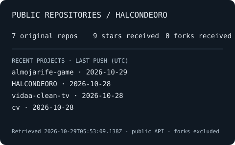

Founder at [MACD Adaptive](https://macd.ie). I work on booking systems, websites, WhatsApp and automation for small businesses in Ireland, alongside open-source experiments.

Trabajo en herramientas prácticas para pequeños negocios. Hablo español e inglés.

[MACD · current work](https://macd.ie) · [CV repository](https://github.com/HALCONDEORO/cv) · [CV website](https://halcondeoro.github.io/cv/)

## Projects in progress

- **[MACD Adaptive](https://macd.ie)** — current work on booking systems, reminders, websites and WhatsApp ordering for small businesses. Tools under development, with a focus on accessibility and plain language.
- **[Almojarife](https://github.com/HALCONDEORO/almojarife-game)** — an open-source sea-trading browser game set on the Iberian and Mediterranean coast in the 15th–16th centuries. Early development, in English and Spanish. [Try the development build](https://halcondeoro.github.io/almojarife-game/).
- **[Sign-language mosaic](https://github.com/HALCONDEORO/jw-sign-mosaic)** — an experimental personal video-wall page for sign-language videos from a public streaming catalog. Early development.

## Public repository activity

Public, original repositories only - the card shows the counts and when they were retrieved.

How the stats are generated

Counts cover public, non-fork repositories owned by **HALCONDEORO**. Stars and forks are received on those original repositories. Recent projects are the four most recently pushed originals with a recorded push date; dates are repository push dates, not personal commit counts or evidence of a release. Empty repositories still count toward totals.

The SVG is generated locally by [a dependency-free Node 22 script](scripts/stats.mjs), using only the anonymous, paginated public GitHub API. Its UTC timestamp records the successful retrieval. A [workflow](.github/workflows/profile-stats.yml) attempts a refresh on pushes to `main`, every six hours, and on manual dispatch. On failure it keeps the last successful artifact and reports an error; the displayed timestamp may therefore be older.

No external stats widgets, private activity, visitor tracking or skill scores.

Run `node --test test/stats.test.mjs` to test with fixtures, then `node scripts/stats.mjs` to refresh from the public API. No packages, credentials or PAT are needed for either command. GitHub's built-in workflow token is used only to save the SVG back to this repository.

The test job also runs on pull requests with read-only token. Only the writer job has `contents: write`, and it runs on `main` alone, never on a pull request. Automatic pushes do not trigger another run with the built-in token. A failed API request, including rate limiting, fails the update without replacing the SVG.

Changes should go through one reviewed PR with CI checked before merging, with no automerge. This workflow consumes standard GitHub-hosted runner time; no paid service or add-on is configured. No PR is created by the generator.

